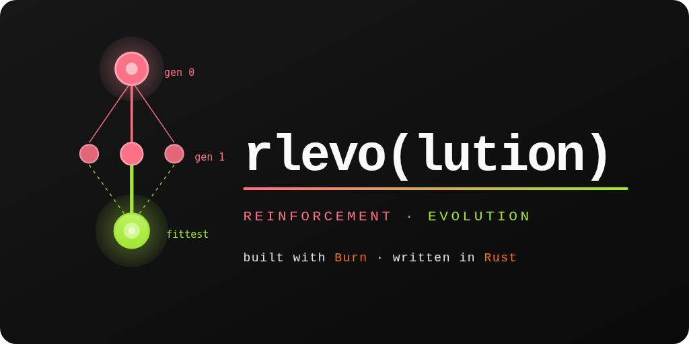

# rlevo-rerun

A [rerun](https://rerun.io) recording sink for the `rlevo` evaluation
harness.

## Status

**Unreleased.** The crate exists and links rerun's SDK; it exports nothing
yet.

`rlevo-rerun` is the one crate in the workspace that depends on rerun. The
harness (`rlevo-harness`) reports a run through its `Reporter` trait and
knows nothing about rerun; this crate turns those reports into `.rrd`
recordings that the rerun viewer opens.

## Versions

rerun guarantees that a recording opens only across adjacent minor
versions. So this crate has its own release line, separate from the other
`rlevo` crates: it releases when rerun moves a minor, and it pins rerun with
a caret inside one minor.

## License

MIT OR Apache-2.0
